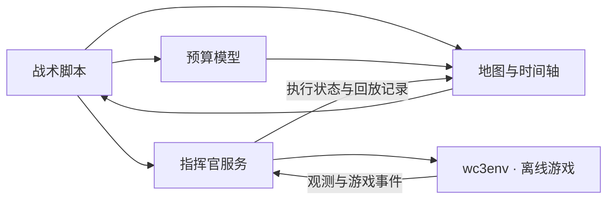

<div align="center">

# WC3 Commander · 魔兽指挥官

**把一局魔兽，编排成看得见的策略。**

在地图上安排位置，在时间轴上安排动作，再到真实游戏中验证。

A visual strategy workbench for Warcraft III 1.27a — plan on a map, arrange actions on a timeline, and inspect what actually happens.

[原型图集](docs/prototype-gallery.md) · [快速开始](#快速开始) · [功能状态](#功能状态) · [使用说明](docs/guide.md) · [MIT 许可证](LICENSE)

`二维沙盘` · `战术脚本` · `单位与队伍生命周期` · `离线单机`

</div>


> **截图来自 Claude 中的「指挥官控制台 v8」交互原型（2026-10-21）。** 原型用于展示交互设计；其中的实战、回放和部分统计使用示意数据。仓库当前实现与验证范围见下方[功能状态](#功能状态)。

## 从“手速”到“编排”

“这个农民先造祭坛，再伐木；那几个人等英雄出生，一起去清分矿。”

WC3 Commander 把这些意图变成可编辑的步骤。你能看到每个单位什么时候出发、去哪里、等待什么，以及下一步要做什么。移动一个工地或修改一个时间条件，就能检查整套计划如何变化。

- **在地图上想清楚位置。** 框选单位，查看路线和建筑占地，拖动工地与动作节点。
- **在时间轴上看清楚顺序。** 每个农民、建筑、英雄都有轨道；采集、建造、生产和等待以色块表示。
- **用条件表达战术。** 支持指定时间、前一步完成后、建筑完成后，以及资源满足时再执行。
- **把几个人编成一支队伍。** 原型展示成员加入、未来单位出生后加入、共同行动和解散后的个人安排。
- **让结果可以核对。** 执行层根据游戏回报更新状态；命令被接受，不等于动作已经完成。

当前围绕 **人族 · 失落神庙 · 速矿二本** 这一个具体场景打磨，目标是逐步形成可复用的策略编排工具。

## 看看它怎么工作

### 单位的一生，画在地图上

选中一个农民，就能把它的采集、集合、建造和后续安排连起来看。右侧逐步编辑，左侧直接观察路线。


### 一支队伍，共享一段计划

成员保留自己的安排，加入队伍后执行共同步骤。原型还展示了“未来单位出生后加入”的入口。


### 同一份策略，两种阅读方式

<table>
<tr>
<td width="50%"><strong>步骤卡片</strong><br>从左到右读懂每个单位要做什么。</td>
<td width="50%"><strong>建筑生产时间轴</strong><br>查看建造、训练、升级与资源变化。</td>
</tr>
<tr>
<td><a href="docs/images/prototype-v8/04-cards.png"></a></td>
<td><a href="docs/images/prototype-v8/05-production.png"></a></td>
</tr>
</table>

更多画面，包括**建造规划、开始条件、实战示意和回放示意**，见 [完整原型图集](docs/prototype-gallery.md)。所有图片都可点击查看原尺寸。

## 功能状态

原型、仓库代码和实机验收分别记录，方便你知道下载后能体验到哪一步。

| 范围 | 当前状态 |
| --- | --- |
| 新控制台：地图、时间轴、预算、脚本编辑 | 已接入仓库；支持修改重算、撤销和保存 |
| 单位与队伍编排 | 新控制台提供相关交互；完整游戏行为仍需按场景验证 |
| 实战连接、运行中改脚本、回放 | 当前已提交版本使用 `old.html`；新控制台中的对应状态仍在接入 |
| 原型中的实战与回放 | 交互示意，不是实际游戏录像，也不证明后端已完成 |
| Windows 真实游戏 | 已有启动、连接和部分开局动作的验证记录；不是所有战术都已验收 |
| 经济预算、封家、清野估时 | 含尚未校准的假设；不能当作真实对局的精确预测 |
| AI 建议 | 目前为规则占位，尚未接入大模型策略生成 |

可查看 [实机启动记录](docs/validation/2026-10-19-startup/README.md)、[开局验证](docs/validation/2026-10-19-opening/README.md)、[农场复验](docs/validation/2026-10-19-farm-retest/README.md) 和 [已知问题](docs/已知问题-2026-10-20.md)。

## 快速开始

### 在 Mac / Linux / Windows 查看编排

需要 **Python 3.11+**。假游戏模式无需安装魔兽，也不会启动真实游戏。新页面需要本地服务，不能只双击 HTML。

在同一父目录准备两个仓库：

```sh
git clone https://github.com/1850VV/wc3-commander.git
git clone --branch cross-platform-import https://github.com/1850VV/wc3env-127a.git
cd wc3-commander/bridge
python3 -m commander_bridge --backend fake --wc3env ../../wc3env-127a/src
```

Windows 可将 `python3` 换成 `python`。浏览器打开 **<http://127.0.0.1:8790/>**。

1. 从默认的人族速矿脚本开始，拖动红线查看不同时间的地图与预算。
2. 在地图或时间轴选中单位，查看它的步骤，调整时间条件或建筑位置。
3. 检查重算结果；需要保留时点击「保存」。

旧控制台入口是 **<http://127.0.0.1:8790/old.html>**，可用于当前已接通的实战与回放功能。

### 连接真实游戏

需要 Windows、你自己的合法 **Warcraft III 1.27a（1.27.0.52240）** 安装，以及已配置并编译的 [wc3env-127a](https://github.com/1850VV/wc3env-127a)。具体依赖分支、启动方式和验收步骤见 [使用说明](docs/guide.md)。

默认等待用户手动开局；`--launch` 是显式测试开关。**仅用于离线单机，不用于战网或联网对局。**

## 一个可读的战术脚本

下面是语法示意，位置需要在脚本中定义，完整可运行样例见 [人族速矿二本](strategies/战术脚本-人族速矿二本.txt)。

```text
农民4：建造 国王祭坛 @祭坛 → 伐木 主矿
农民8：[大法师出生前 10 秒] 敲钟 → 加入 清野小队 → 采金 分矿
队伍 清野小队：集合 @前方空地 → 清野 @分矿 → 解散
```

时间轴与沙盘是这份脚本的可视化入口。语法与执行规则见 [战术脚本说明](docs/战术脚本-草稿.md)。

## 数据怎样流动



新界面的执行状态与回放仍在接入，当前通过旧控制台使用。浏览器界面使用原生 JavaScript，服务使用 Python；游戏适配由独立的 `wc3env-127a` 提供。

## 开发与验证

```sh
# 在 wc3-commander 根目录运行；需要 Node.js 和 Python 3.11+
node --test web/tests/sim.test.js
node --test web/tests/script-editor.test.js
node --test web/tests/budget.test.js
WC3ENV_SRC=../wc3env-127a/src python3 -m unittest discover -s bridge/tests -t bridge
```

这些测试覆盖模拟、脚本、预算与假游戏服务。真实游戏、原型交互与游戏资源授权需要分别核验，不能用单元测试替代。

| 入口 | 内容 |
| --- | --- |
| [`web/console/`](web/console/) | 新控制台：地图、时间轴、页面状态 |
| [`web/budget.js`](web/budget.js) | 战术脚本的时间与资源预算 |
| [`bridge/commander_bridge/`](bridge/commander_bridge/) | 脚本解析、调度、服务与游戏连接 |
| [`strategies/`](strategies/) | 可保存、可同步的战术与布局 |
| [详细使用说明](docs/guide.md) | 实现细节、数据假设与旧控制台操作 |
| [原型图集](docs/prototype-gallery.md) | Claude v8 的完整截图、来源与展示边界 |

欢迎通过 [Issues](https://github.com/1850VV/wc3-commander/issues) 反馈可复现的问题，或提交聚焦的小型改进。涉及游戏行为时，请附版本、地图、出生点、脚本和观测记录。

## 许可证与来源

本项目原创代码采用 **[MIT 许可证](LICENSE)**，Copyright © 2026 1850VV。允许修改、分发和商用，并须保留版权与许可声明。

MIT 授权仅覆盖有权授权的原创部分。魔兽争霸的地图派生数据、游戏数值、截图中的第三方元素、字体及外部依赖仍遵循各自权利和条款，详见 [第三方说明](THIRD_PARTY_NOTICES.md)。这份许可证不授予游戏资产或商标的使用权。

Warcraft 是 Blizzard Entertainment 的商标。本项目与 Blizzard Entertainment 无关联，也未获其背书。
