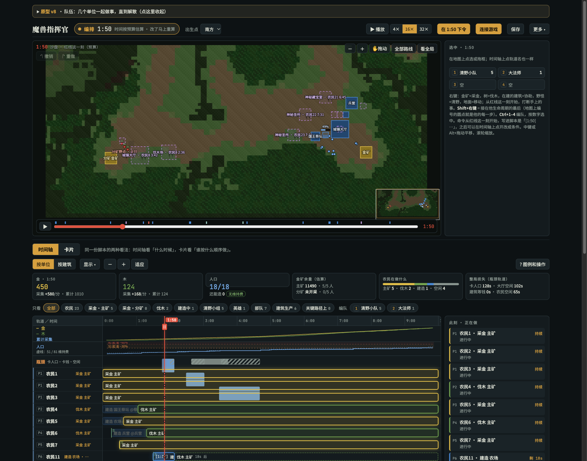
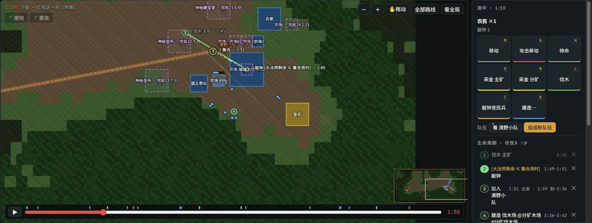
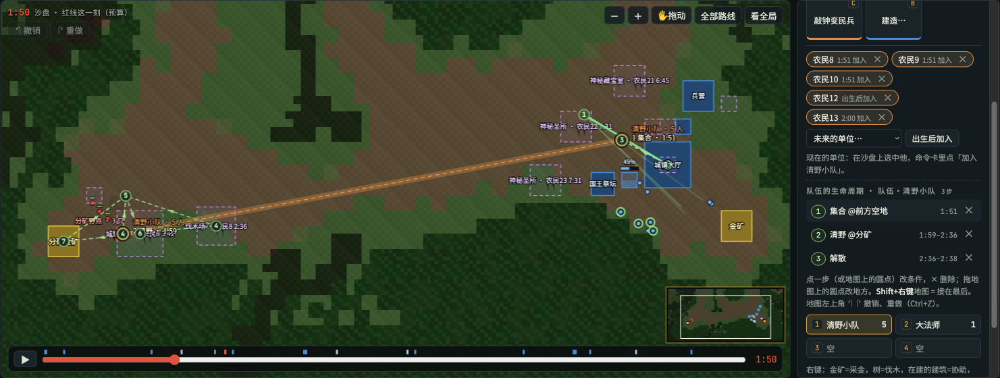
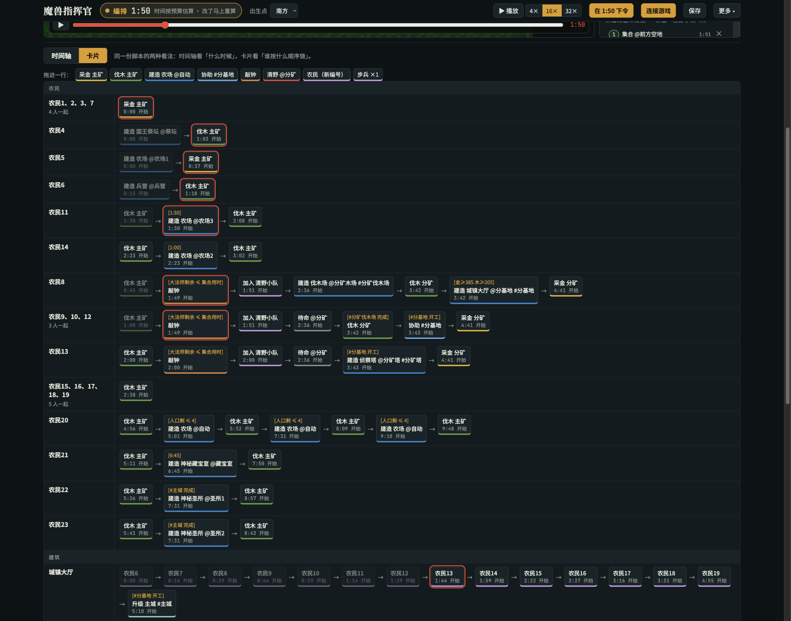
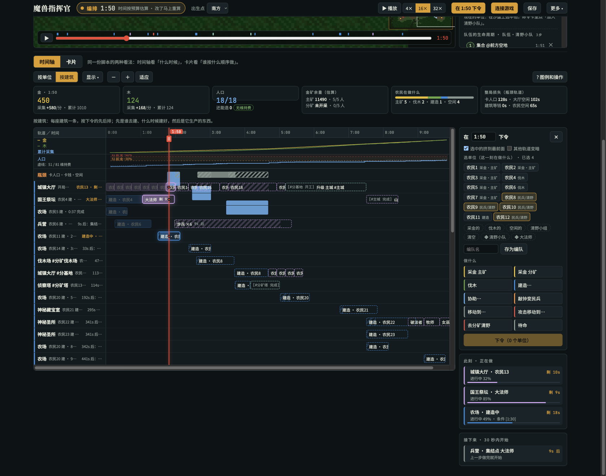
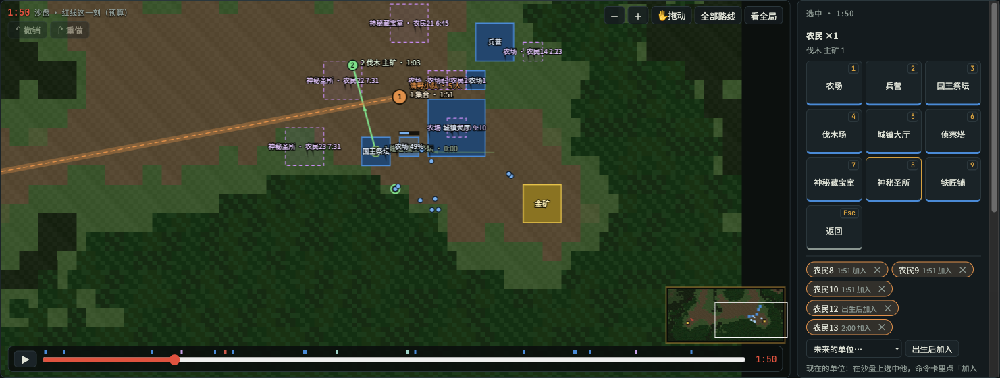
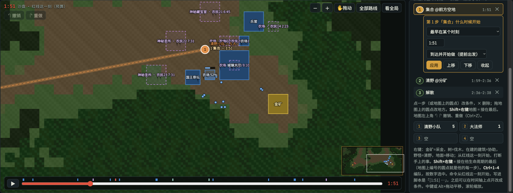
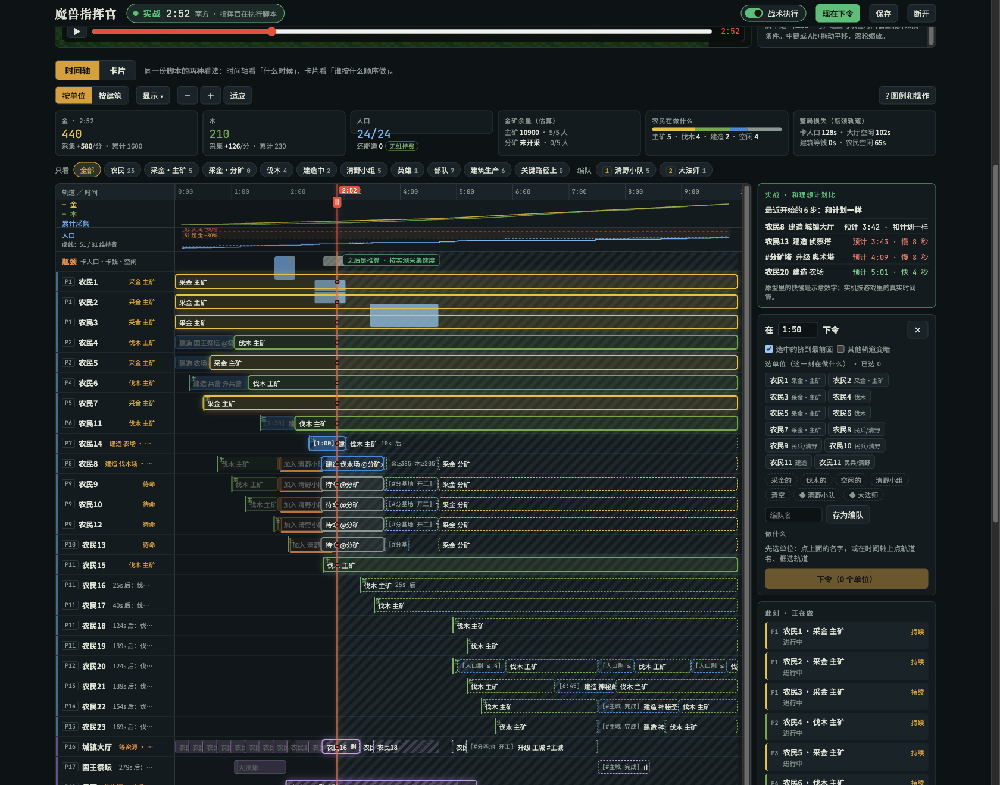
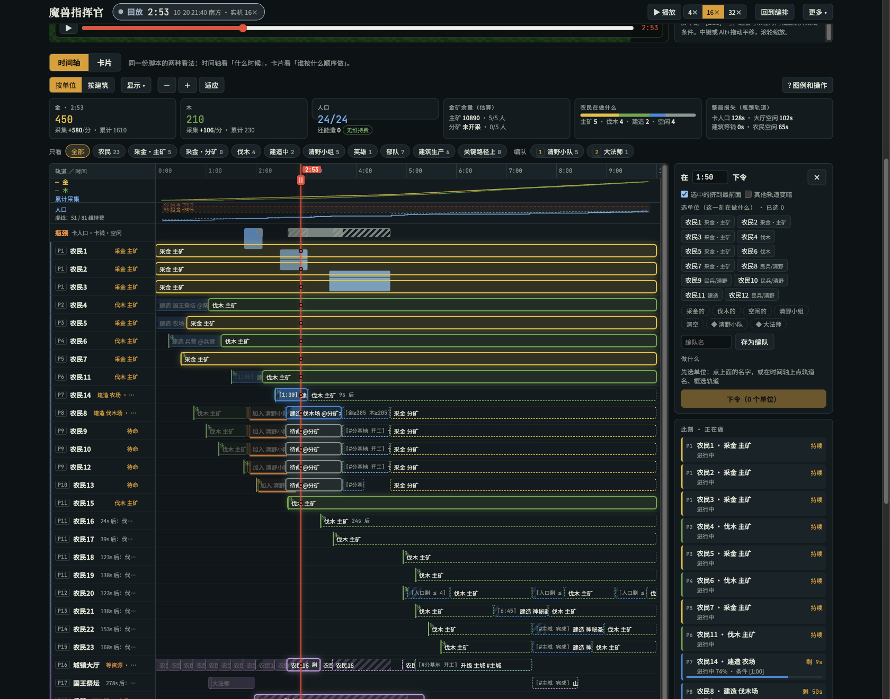

# 指挥官控制台 v8 · 原型图集

[返回项目首页](../README.md)

这些截图来自 Claude 中的最新「指挥官控制台 v8」交互原型，展示地图、时间轴、生命周期与编排方式。**本页全部是原型截图**，其中实战、回放和部分统计为示意数据，不是实际对局记录。仓库当前支持范围见 [功能状态](../README.md#功能状态)。

## 01 · 全局编排

地图确定位置，时间轴确定顺序，资源面板提供预算。红线让它们停在同一个时间点。

## 02 · 单位生命周期

一个农民从伐木、变民兵，到加入队伍、建造和采集。地图上的编号与右侧步骤对应。

## 03 · 队伍与未来成员

清野小队有成员列表，也有共同的集合、清野和解散步骤。还未出生的单位可以安排出生后加入。

## 04 · 战术卡片

从左到右阅读每个单位的动作顺序，卡片显示条件和预计开始时间。原型中的拖拽排序、跨行改派仍包含设计示意。

## 05 · 建筑生产时间轴

切到“按建筑”，检查建造、训练、升级与等待如何衔接，并对照资源和人口曲线。

## 06 · 建造规划

选中单位后打开建造面板，在地图上查看已有和计划中的建筑。工地位置、路线和后续动作在同一界面中表达。

## 07 · 开始条件

原型区分“到达并开始做”与“从这时出发”，用于表达提前赶路还是到点再走。截图展示条件编辑器，不代表调度与动画的所有边界情况已经通过验证。

## 08 · 实战状态示意

展示“已经发生的动作 + 后续推算”及计划与实际的比较方式。**此图的实战时间、状态和差异数值由原型模拟。**

## 09 · 回放状态示意

展示对历史步骤的查看与时间定位。**这不是实际游戏录像。** 真实运行与回放记录请查阅仓库的实机验证文档。

## 截图来源

| 项目 | 记录 |
| --- | --- |
| 原型 | Claude「指挥官控制台 v8」 |
| 原型本地预览文件 | `view10.html`（与 v8 对应的完整 HTML 预览） |
| 核验与截图日期 | 2026-10-21，Asia/Shanghai |
| 原型文件 SHA-256 | `c91dbceb2ccc8d8dc13e09853b592e9c5b7b431f63143d53f99ba7ccf57163eb` |
| 截图方式 | 独立浏览器会话打开原型副本，使用界面控制切换状态后截图 |
| 内容处理 | 页面或功能区域截图；未重绘界面，未加入真实运行结果 |

图片仅包含原型界面，不包含 Claude 对话、账户信息或本机路径。游戏与第三方元素的权利见 [第三方说明](../THIRD_PARTY_NOTICES.md)。
