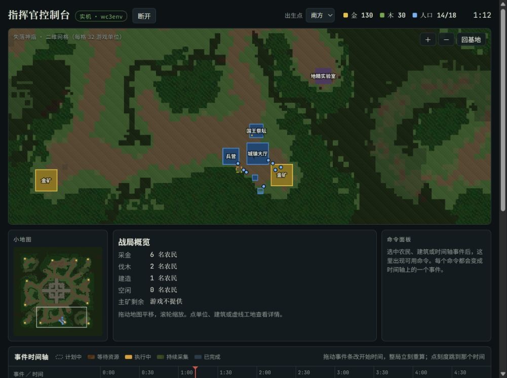
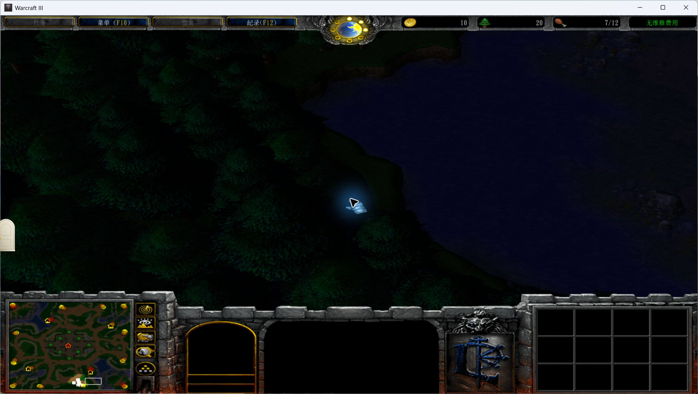

# 2026-10-19 Windows 实机启动验收

**结论：启动验收第 1–4 步通过。** 已实际启动 wc3env、通过浏览器点击「连接 魔兽争霸三」，观察到原生游戏窗口和持续更新的游戏状态。完整开局行为验收、两分钟画面对照和原生事件丢失计数仍未验证。

记录时间：2026-10-19 12:04–12:08（Asia/Shanghai）。本目录归档当次结果，不代表读取此文档时服务仍在运行。此次发布只整理既有记录，没有重新启动或接管游戏。

## 环境与输入

| 项目 | 本次使用 |
|---|---|
| commander | [`fcdb1f37c39e49a485aed5ca1c4524caf8fdaf20`](https://github.com/1850VV/wc3-commander/commit/fcdb1f37c39e49a485aed5ca1c4524caf8fdaf20)，`main` |
| wc3env | 本地现有 `wc3env-127a` 工作树，`codex/archmage-kiting-mvp`，HEAD `85fcefdf1f9019dd92a40e109d544ec656d0d158`；原有修改见 [preflight.json](evidence/preflight.json) |
| Python | 同一个 wc3env `.venv`，CPython 3.12.10，64 位 |
| Warcraft III | 本地 1.27a，构建号 `1.27.0.52240`；保留可执行文件与 DLL 校验 |
| 地图 | `Maps/(4)LostTemple.w3m`，245236 字节，游戏 Maps 子树中正好一份 |
| bridge | `wc3env` 后端、默认 `--opponent none`、实时模式、可见后台窗口 |

游戏安装、已编译的 Hook DLL 和 `.env` 均来自本地既有环境，不能仅靠克隆 commander 仓库复现。此次发布不包含游戏二进制、地图或 `.env`。版本与文件 SHA-256 记录在 [原始报告的公开副本](evidence/REPORT.txt) 中。

## 逐项验收

| 验收项 | 结果 | 本次实际证据 |
|---|---|---|
| 1. 安装 wc3env 并实际推进 | PASS | 两条命令退出码均为 0；`20/20 exact`，推进 5 秒游戏时间，耗时 0.36 秒。此 CLI 步骤使用默认 Echo Isles 地图，随后由 bridge 启动 Lost Temple。见 [安装日志](evidence/step1-pip.log)、[推进日志](evidence/step1-native.log)、[退出码](evidence/step1-native-result.json) |
| 2. 取得目标 commander 源码 | PASS | 原目录仅有空 `.git`；配置指定 origin 后 fetch 并检出 `main`，未覆盖用户源码。见 [fetch 日志](evidence/step2-fetch.log) |
| 3. Lost Temple 地图唯一性 | PASS | 递归计数为 1，结束时复核仍为 1；无需复制、改名或删除。见 [地图路径与哈希](evidence/step3-maps-before.json)、[结束状态](evidence/final-state.json) |
| 4. bridge、浏览器连接、原生游戏 | PASS | 点击真实按钮后，health 从 `running: false` 变为 `true`；出现 Warcraft III 窗口。366 条 SSE 记录中的游戏时间从 0 推进至 86.2 秒。见 [连接前](evidence/step4-health-before.json)、[连接后](evidence/step4-health-connected.json)、[进程链](evidence/step4-processes.json)、[SSE 记录](evidence/bridge-stream.jsonl)、[Hook 日志](evidence/step4-hook-20788.log) |

实际执行命令（分别在 wc3env 根目录和 commander 的 `bridge` 目录）：

```powershell
python -m pip install -e .
python -m wc3env --instances 1 --steps 20 --stepms 250 --speed 64

# wc3-commander/bridge
python -m commander_bridge --backend wc3env
```

随后在 `http://127.0.0.1:8790/` 点击「连接 魔兽争霸三」。按照 wc3env 的测试约定设置 `WC3_SOUND=0`；helper 使用隐藏窗口，游戏保持可见。点击前没有正在运行的 Warcraft/bridge，8790 端口空闲。

验收结束时 bridge 工作进程 PID 为 26572（启动器 PID 34404），游戏 PID 为 20788，二者和浏览器页面保留运行；只停止了只读 SSE 记录器。CLI 步骤自己的测试游戏 PID 11328 已由其生命周期管理正常关闭。

## 截图

控制台显示「实机 · wc3env」「断开」与 1:12 游戏时间：



原生游戏窗口，显示实际游戏场景、资源栏和小地图；截图视角未覆盖基地，不能用它逐项验收建筑状态：



另保留了 [时间轴截图](evidence/console-connected.jpg)。这些截图来自同一次运行的不同时间点，不是严格同步的画面对照。

## 测试与已知限制

- bridge 测试：`python -m unittest discover -s bridge/tests -t bridge`，7/7 通过，退出码 0；[日志](evidence/commander-bridge-tests.log)。
- README 的 `node --test web/tests` 在 Node 24.15.0 上报 `MODULE_NOT_FOUND`，退出码 1；[首次失败日志](evidence/commander-web-tests.log) 保留。
- 使用显式文件 `node --test web/tests/sim.test.js` 后，网页测试 6/6 通过，退出码 0；[通过日志](evidence/commander-web-tests-explicit-files.log)。
- 浏览器请求 `/favicon.ico` 返回 404；[bridge stderr](evidence/bridge-stderr.log) 保留。采集期间没有连接异常或 SSE 错误消息。
- 本次没有修改项目实现。对 wc3env 原有受版本控制文件和未忽略的新文件逐一比对 SHA-256，内容保持一致。
- 完整开局五事件、约两分钟的游戏/时间轴同步对照：**NOT_RUN**，不能由界面完成标签或单元测试通过推导。
- 原生 `events_lost=0`：**NOT_VERIFIED**，bridge 状态流没有暴露这个计数，未另行抢占原生连接审计。

## 证据完整性与公开处理

[manifest.json](manifest.json) 列出 26 个证据文件、原始 SHA-256、公开副本 SHA-256 和处理方式。截图保持原字节；文本仅替换本机路径前缀，并规范 UTF-8/LF 或 JSON 格式，保留时间、PID、命令参数、失败与输出数值。

截图工具返回的是 JPEG，原记录文件名用了 `.png`；公开副本更正为 `.jpg`，未转码。清单的 `source_name` 保留原名，`REPORT.txt` 中的图片名称仍指原始记录。

- `<WORKSPACE_ROOT>`：包含 `wc3-commander` 与 `wc3env-127a` 的工作目录。
- `<USER_PROFILE>`：Windows 用户目录。
- `<WC3_GAME_DIR>`：本地 1.27a 游戏安装目录。
- `<WC3_OUTPUT_DIR>`：wc3env 每进程隔离输出目录的父目录。

未上传完整本地文件清单、Git 配置、临时停止标志和发布辅助脚本。原始完整证据仍保存在本地；`REPORT.txt` 中“未创建提交/推送”等表述指此前验收阶段，非本次归档发布操作。
